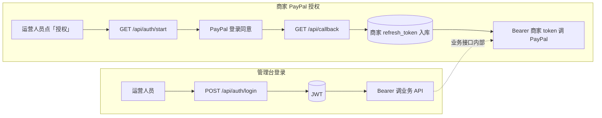
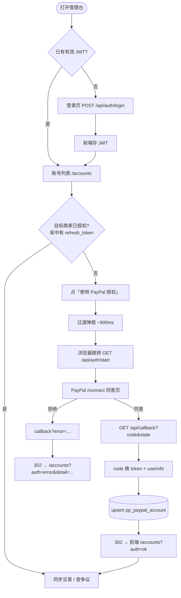
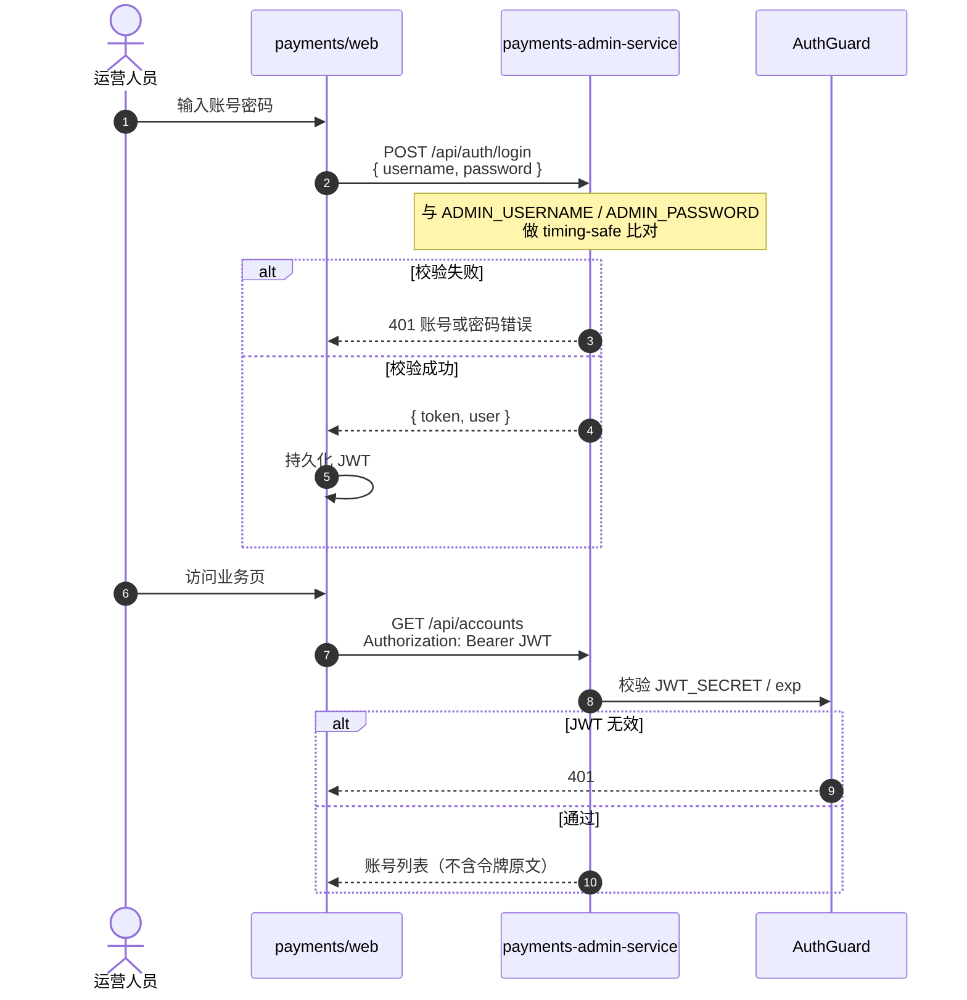
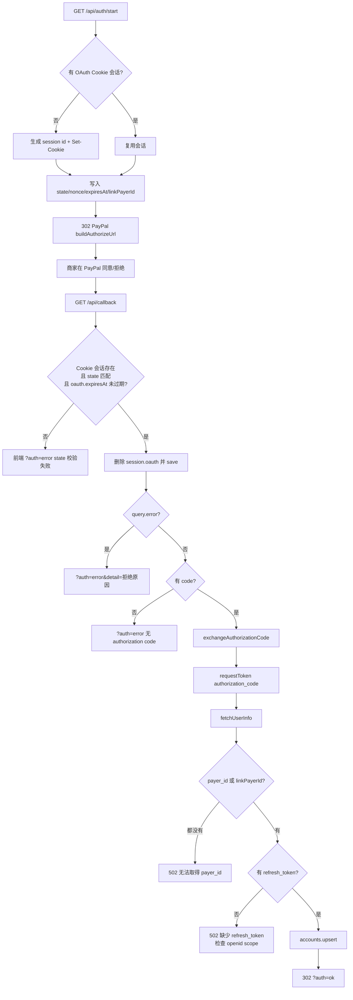
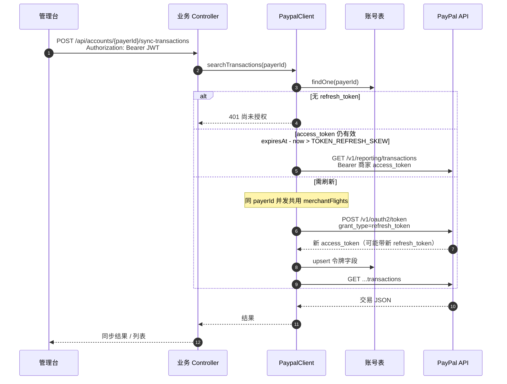
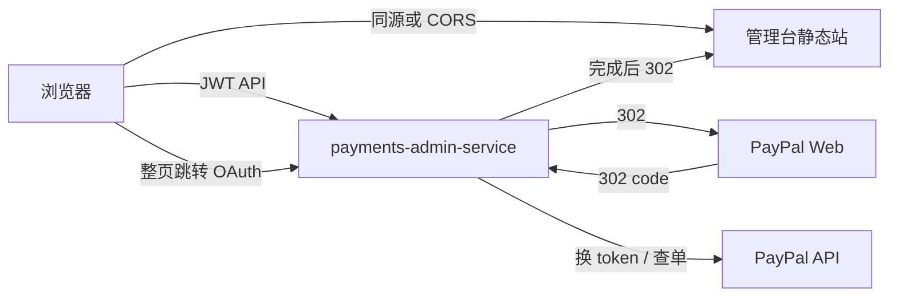
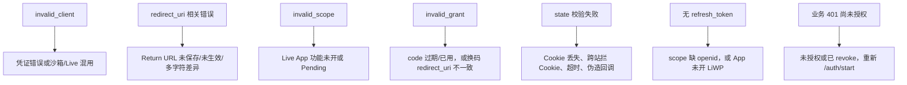

# 授权流程图

本文描述 **Payments 管理台** 里两套独立授权如何衔接，并给出可在 Markdown 预览中渲染的 Mermaid 图。选型说明见 [实施方案.md](实施方案.md)；PayPal「商家登录授权」细节见 [01-商家登录授权.md](01-商家登录授权.md)。

---

## 0. 两套授权（先分清）

| 层级 | 谁登录 | 凭证 | 用途 |
| --- | --- | --- | --- |
| **管理台登录** | 运营人员 | 本服务签发的 **JWT**（`ADMIN_USERNAME` / `ADMIN_PASSWORD`） | 访问 `/api/accounts`、`/api/disputes` 等业务接口 |
| **商家 PayPal 授权** | 商家 PayPal 账号 | 平台 App 换出的 **商家 access_token + refresh_token** | 代该商家调 PayPal Orders / Transaction Search / Disputes |

两者不能互换：JWT 进不了 PayPal；商家 token 也不能当管理台登录态。



---

## 1. 总览：从打开页面到能查交易



---

## 2. 管理台登录时序

对应：`payments-admin-service` → `LocalAuthController`；前端 `store/auth` + `POST /api/auth/login`。



说明：

- `/api/auth/login`、`/api/auth/start`、`/api/callback` 标了 `@Public()`，不强制 JWT。
- PayPal 授权跳转是**整页导航**，不带 `Authorization` 头；OAuth 会话靠 **HttpOnly Cookie**（见下节）。

---

## 3. 商家 PayPal 授权（主流程）

对应：前端 `lib/oauth.ts` → `OauthController` → `PaypalClient.exchangeAuthorizationCode` → `AccountService.upsert`。

### 3.1 时序图

```mermaid
sequenceDiagram
  autonumber
  actor Op as 运营人员
  participant Web as 管理台前端
  participant API as OauthController
  participant Sess as OauthSessionService<br/>(pp_oauth_session)
  participant PP as PayPal
  participant Acc as AccountService<br/>(账号表)

  Op->>Web: 点击「授权」<br/>可选带 accountId=payerId
  Web->>Web: 展示 PpOAuthRedirectModal
  Web->>API: GET /api/auth/start?accountId=...

  API->>API: assertCredentials()
  API->>Sess: 读 Cookie 会话；无则 start() 并 Set-Cookie
  Note over Sess: Cookie: OAUTH_COOKIE_NAME<br/>HttpOnly; SameSite=Lax; Path=/
  API->>Sess: 写入 oauth.state / nonce / expiresAt / linkPayerId
  API-->>Web: 302 → PayPal 授权 URL

  Web->>PP: 打开 /connect?...&state&nonce&scope&redirect_uri
  Op->>PP: 用商家账号登录并同意

  alt 商家同意
    PP-->>API: 302 GET /api/callback?code&state
  else 商家拒绝
    PP-->>API: 302 GET /api/callback?error&error_description
  end

  API->>Sess: 用 Cookie 读会话，核对 state 且未过期
  API->>Sess: 立刻清除 session.oauth（一次性）

  alt state 失败 / 过期 / 无 code / 有 error
    API-->>Web: 302 FRONTEND_URL/accounts?auth=error&detail=...
  else 正常
    API->>PP: POST /v1/oauth2/token<br/>grant_type=authorization_code
    Note over API,PP: Basic(client_id:secret)<br/>redirect_uri 须与授权时一致
    PP-->>API: access_token, refresh_token, scope, expires_in
    API->>PP: GET userinfo?schema=paypalv1.1
    PP-->>API: payer_id, email, name
    API->>Acc: upsert 商家账号<br/>status→active（或保留 frozen）
    API-->>Web: 302 FRONTEND_URL/accounts?auth=ok
  end
```

### 3.2 关键节点（与代码一一对应）



### 3.3 重新授权（带 `accountId`）

当 userinfo 偶发拿不到 `payer_id`，或运营人员从「某账号详情」发起授权时：

1. 前端：`startPayPalOAuth(payerId)` → `/api/auth/start?accountId={payerId}`
2. 服务端把 `accountId` 存进会话的 `linkPayerId`
3. 换码后：`payerId = userinfo.payer_id || linkPayerId`
4. 有 `linkPayerId` 时可回绑原账号行，避免 profile 失败导致「幽灵新账号」

```mermaid
flowchart LR
  Detail[账号详情页未授权] -->|accountId=RMY...| Start[/auth/start]
  Start --> Sess[(oauth.linkPayerId)]
  Sess --> Callback[/callback]
  Callback --> Merge{userinfo.payer_id?}
  Merge -->|有| UsePP[用 PayPal payer_id]
  Merge -->|无| UseLink[用 linkPayerId 回绑]
  UsePP --> DB[(upsert 同一 payerId)]
  UseLink --> DB
```

---

## 4. 授权后：业务调用如何用商家令牌

管理台请求只带 **JWT**；服务端内部再换成 **商家 access_token** 调 PayPal。



解除授权：`DELETE /api/accounts/{payerId}` → `AccountService.clearTokens`，清空令牌并把 `active` 改回 `pending`，之后必须重新走第 3 节流程。

---

## 5. 部署拓扑与 URL 对齐

沙箱示例（正式把 host / 凭证换成 Live 即可，**禁止混用**）：

| 配置 | 含义 | 示例 |
| --- | --- | --- |
| 前端 | `FRONTEND_URL` / CORS | `https://payments-sandbox.ouyishop.com` |
| API | Nginx 反代到 Nest | `https://payments-sandbox-api.ouyishop.com` |
| OAuth 入口 | `VITE_PAYPAL_OAUTH_START` | `…/api/auth/start` |
| Return URL | `PAYPAL_REDIRECT_URI` **且** App Dashboard Return URL | `…/api/callback` |
| 授权页 | sandbox / live | `www.sandbox.paypal.com/connect` 或 `www.paypal.com/connect` |
| Token API | sandbox / live | `api-m.sandbox.paypal.com` 或 `api-m.paypal.com` |



**必须逐字一致：**

1. `PAYPAL_REDIRECT_URI` ≡ Developer Dashboard 的 Return URL ≡ 授权请求里的 `redirect_uri` ≡ 换 token 时的 `redirect_uri`
2. `PAYPAL_CLIENT_ID` / `SECRET` 与 `PAYPAL_ENV`（sandbox|live）匹配
3. Live 需 App 已开通 Log in with PayPal，且所需 scope（交易、争议等）已批准；否则会出现 `invalid_client` / `invalid_scope`

---

## 6. 异常路径速查



回调失败时用户看到：`/accounts?auth=error&detail=…`（detail 截断约 300 字符）。成功：`/accounts?auth=ok`；若 userinfo 有非致命错误会带 `&profile=…`。

---

## 7. 代码索引

| 环节 | 位置 |
| --- | --- |
| 前端发起 OAuth | `payments/web/src/lib/oauth.ts` |
| 过渡弹框 | `payments/web/src/components/PpOAuthRedirectModal.vue` |
| 管理台登录 | `…/auth/local-auth.controller.ts` |
| OAuth start / callback | `…/oauth/oauth.controller.ts` |
| OAuth Cookie 会话 | `…/oauth/oauth-session.service.ts` |
| 拼授权 URL / 换码 / 刷新 | `…/paypal/paypal.client.ts` |
| 账号落库 / 清令牌 | `…/account/account.service.ts` |
| 前端 API 封装 | `payments/web/src/api/paypal.ts`、`http.ts` |

---

## 8. 与文档 01 的关系

- [01-商家登录授权.md](01-商家登录授权.md) 讲 **方案原理、PayPal 请求字段、安全清单**（偏协议与运维准备）。
- **本文**讲 **本仓库管理台的实际跳转、Cookie、state、双层登录与刷新时序**（偏实现与排障）。

两份对照阅读：先看本文走通路径，再回 01 核对 Dashboard 勾选项与 scope。
